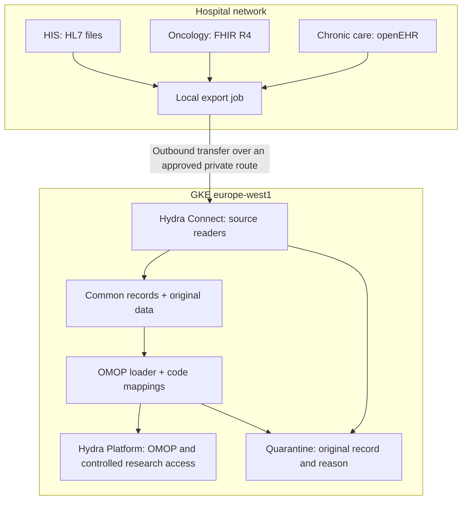

# Proposed architecture

- **Local export job:** reads inside the hospital and sends outward; clinical systems do not need public ingress. It buffers failed transfers and keeps a checkpoint.
- **Hydra Connect:** uses a reader for each format. The openEHR reader uses the actual cardiology/diabetes template versions, an `ehr_id` to MRN crosswalk, composition UID/version, node paths, dates and units. Unknown templates are quarantined.
- **Common records:** let the loader work independently of the source format. Production storage keeps versioned source batches; the exercise uses JSONL on disk.
- **OMOP loader:** links patients/visits, applies reviewed mappings and writes the relevant OMOP tables. Numeric results go to Measurement after unit and clinical review.
- **Hydra Platform:** serves an approved cohort to authorised users. Each hospital has separate storage/database permissions and an authenticated tenant identity.
- **Quarantine:** lets an operator inspect and correct a failed record before replaying its batch through the same reader/loader.

These are proposed responsibilities, not claims about undocumented Hydra APIs. Cloud permissions, encryption, access logs and retention cover original files, common records, quarantine and backups. The hospital approves research use before access is enabled.
